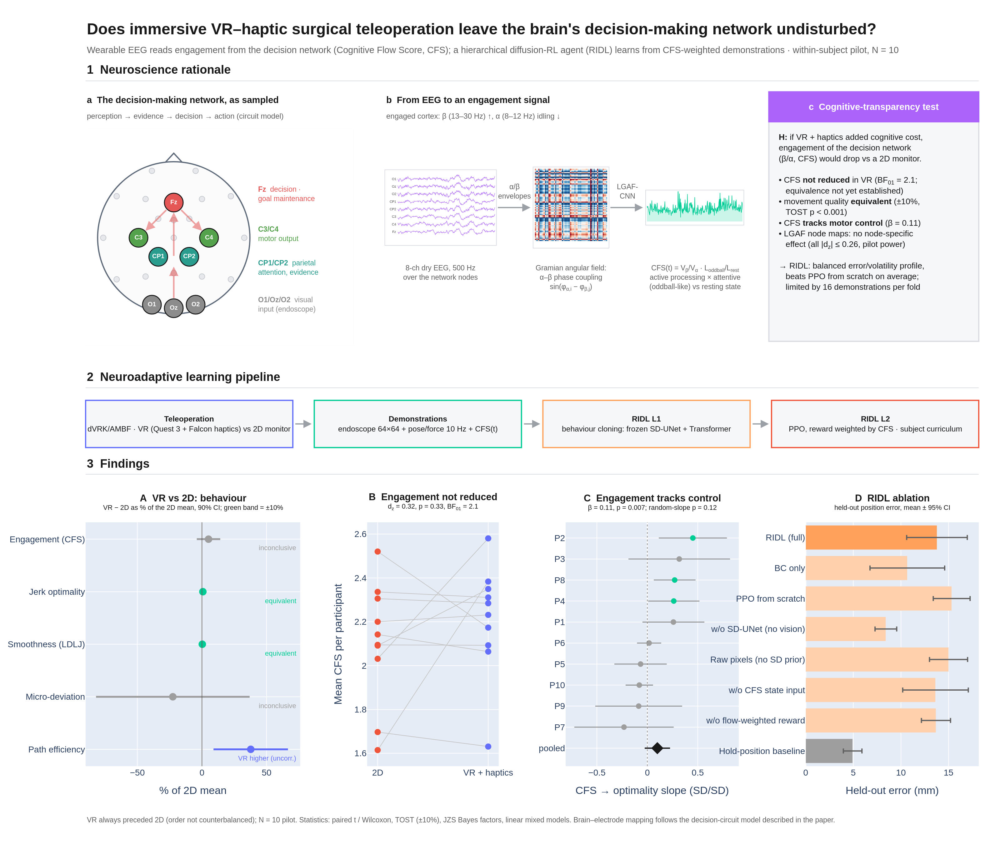

# Neuroadaptive RIDL

**Cognitive equivalence of VR–haptic surgical teleoperation, and a hierarchical diffusion–RL agent trained on EEG-annotated demonstrations.**



This repository holds the code, derived results and manuscript source for the Frontiers in Systems Neuroscience article *Neuroadaptive Decision-Making AI for Immersive Surgical Robotics Training*, an extension of the MCC thesis *Neuroadaptive Decision-Making AI* (Tecnológico de Monterrey, 2025).

Participants (N = 10) teleoperated a dVRK/AMBF simulator under two interfaces, within subject:

- **VR + haptics**: Meta Quest 3 stereo view with Novint Falcon force feedback.
- **2D**: a monitor without haptics.

During each session we recorded 8-channel dry EEG, tool kinematics and endoscope video. We then asked two questions:

1. **Does immersion change how people engage?** We used a continuous Cognitive Flow Score (CFS) from an LGAF-CNN EEG decoder, movement-quality metrics, equivalence tests (TOST) and Bayes factors.
2. **Can the engagement-annotated demonstrations train an autonomous agent?** We tested **RIDL**, a two-level agent. A frozen Stable-Diffusion visuomotor skill prior learned by behavior cloning is refined by PPO on a CFS-weighted reward, across a subject-by-subject curriculum. The test is a subject-wise cross-validated ablation.

## Key results (human data)

| Measure | VR + haptics | 2D | Test |
|---|---|---|---|
| CFS (engagement) | 2.21 ± 0.25 | 2.10 ± 0.28 | d_z = 0.32, p = 0.33, BF₀₁ = 2.1; ±10% equivalence not established |
| Jerk optimality | 0.939 | 0.932 | **equivalent** within ±10% (TOST p < 0.001) |
| Smoothness (LDLJ) | −20.25 | −20.30 | **equivalent** within ±10% (TOST p < 0.001) |
| Path efficiency | 0.36 | 0.26 | d_z = 0.76, p = 0.04 uncorrected (n.s. after Holm) |
| CFS → optimality (5 s windows) | | | β = 0.11, p = 0.007 (random intercept); p = 0.12 with random slopes |

Immersion produced no measurable cognitive or motor cost, and moment-to-moment engagement tracked movement optimality in both interfaces. VR always preceded 2D, so condition order was not counterbalanced; treat this as a pilot. RIDL ablation results are written to `results/ablation_summary.csv` and `paper/results_macros.tex` by `run_all.sh`.

## Repository layout

```
ridl/            RIDLPolicy network and the original thesis training utilities
                 (model, dataset, Gymnasium env, PPO rollout buffer, DH kinematics)
experiments/     Frontiers analyses: every number in the paper comes from here
  common.py                 data loading (thesis conventions)
  human_analysis.py         CFS + kinematics: paired tests, TOST, Bayes factors, mixed models
  extract_unet_features.py  caches the frozen SD-UNet features (one pass over all frames)
  ridl_ablation.py          hierarchical RIDL + ablations + learning curves
  figures_human.py          RGB flow/optimality trajectories, paired plots, CFS–quality
  figures_rl.py             vis2-style trajectory panels + GIF, ablation bars, cross-domain matrix
  visual_abstract.py        docs/visual_abstract.png
  make_macros.py            paper/results_macros.tex + LaTeX tables (no hand-typed numbers)
  run_all.sh                end-to-end reproduction
thesis/          legacy real-time PPO-vs-RIDL viewers (see thesis/README.md for known issues)
notebooks/       preprocessing / LGAF, RGB trajectory encoding, vis2 animation (outputs stripped)
paper/           Frontiers LaTeX source (manuscript.tex, generated macros and tables)
figures/         rendered figures (PNG + PDF)
results/         derived, anonymized results (CSV / JSON)
```

## Setup

```bash
python -m venv .venv && source .venv/bin/activate
pip install -r requirements.txt
```

CPU is sufficient; a GPU only speeds up feature extraction. The Stable-Diffusion v1.5 UNet is downloaded from the Hugging Face hub on first use. If a thesis checkpoint is placed at `checkpoints/ridl_policy_ppo_ds1.pth`, its frozen UNet weights are used instead.

## Data

Raw EEG, video and kinematics are **not distributed** (participant privacy). The code expects them under `data/VR-NVR/`, or a path set in `RIDL_DATA`:

```
data/VR-NVR/
  LGAF/    subject{i}-{RH|LH}-{VR|NVR}_{Reference|Task1|Task2}.csv   (timestamp, pose, forces, Va, Vb, Task_Ratio, F)
  Stream/  subject{i}-{RH|LH}-{VR|NVR}/left_<timestamp>.png          (endoscope frames)
  NIC/     Subject-{i}/*.easy|*.info                                  (Enobio EEG, 500 Hz)
```

The derived, anonymized results used in the paper are in `results/`.

## Reproduce

```bash
cd experiments
PYTHON=python THREADS=16 ./run_all.sh     # ~10 h on a 22-core CPU, mostly the UNet feature pass
```

Individual steps:

```bash
python human_analysis.py && python figures_human.py   # human-data statistics and figures (minutes)
python extract_unet_features.py                       # frozen SD-UNet cache
python ridl_ablation.py --seeds 2                     # ablation grid
python ridl_ablation.py --curves                      # sample-efficiency curves
python figures_rl.py && python make_macros.py && python visual_abstract.py
```

Compile the paper from `paper/` with `pdflatex manuscript && bibtex manuscript && pdflatex manuscript && pdflatex manuscript`. Figures are read from `../figures/`.

## Differences from the thesis implementation

The Frontiers analyses keep the thesis architecture (RIDLPolicy: frozen SD-UNet, Conv1D + 4-layer Transformer, additive fusion, Gaussian policy and value heads) and the two-level BC → PPO training with a subject curriculum. They change the following:

- **Action-dependent reward.** The thesis environment returned the logged reward whatever the action; the reward is now a CFS-weighted tracking term plus a jerk term.
- **Prediction error.** Evaluation measures true prediction error on held-out subjects (5-fold subject-wise CV) against hold-position and constant-velocity baselines. Normalization statistics come from training subjects only.
- **Policy inputs and target.** The numeric encoder receives the kinematic history, as described in the paper's Methods, and the policy predicts 1 s action chunks.
- **Feature caching.** Frozen-UNet features are cached. This is numerically identical to recomputing them and makes the ablation tractable on CPU.

See `thesis/README.md` for the issues found in the original evaluation script.

## Citation

```bibtex
@article{nietogutierrez_neuroadaptive_ridl,
  title   = {Neuroadaptive Decision-Making AI for Immersive Surgical Robotics Training},
  author  = {Nieto Guti{\'e}rrez, Nezih},
  journal = {Frontiers in Systems Neuroscience},
  note    = {under review}
}
```

## License

Code: [MIT](LICENSE). The manuscript text and figures are not covered by this license. Raw participant data are not distributed.
